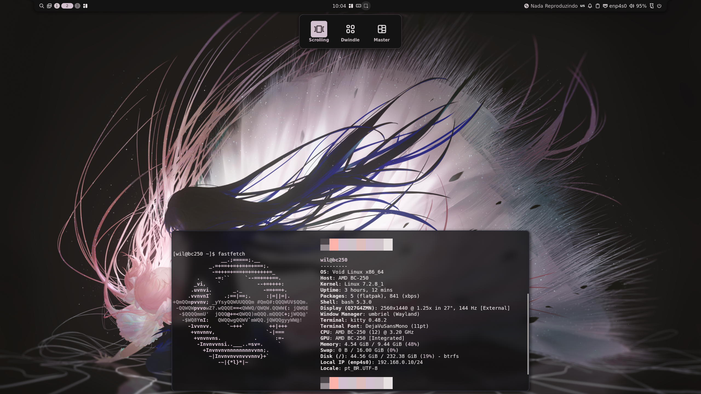

**🌐 Language:** **English** · [Português (BR)](README.pt-BR.md)

# Umbriel for Void Linux (x86_64)

[](https://github.com/Wiljapa/umbriel-void/actions/workflows/build.yml)
[](https://github.com/Wiljapa/umbriel-void/releases/latest)
[](https://voidlinux.org/)
[](LICENSE)

Up-to-date, pre-built binary package of the **[Umbriel](https://github.com/noctalia-dev/umbriel)** Wayland compositor for **Void Linux**.

Umbriel is a modern Wayland compositor built on `wlroots`, with native support for *scrolling*, *dwindle* and *master* layouts, plus shaders and animations.

This repository provides the complete suite:
- **`umbriel`**: Wayland compositor with native compatibility for legacy X11 applications (`xorg-server-xwayland`) and ICC color management (`lcms2`).
- **`xdg-desktop-portal-umbriel`**: Official portal with a screen/window picker (`umbriel-share-picker`) for screen sharing on Discord, Google Meet and recording in OBS Studio.

> When you install `umbriel` through XBPS, the portal and the compatibility components are installed automatically as dependencies!

This repository automatically builds new versions in the cloud (via GitHub Actions) every day, as soon as new commits land in the official Umbriel repository.

> **Note:** the packaged `umbriel` carries patches that translate the compositor UI and the keybind action names to Brazilian Portuguese. They only take effect when `LANG` starts with `pt`; with any other locale the interface stays in English.

<p align="center">
  
</p>

---

## ⚡ Installation

You can install Umbriel in two ways: as a native Void Linux repository (recommended, so you receive automatic updates from the system) or with a one-line script.

### Method 1: Native XBPS Repository (Recommended)
Add the repository to your Void Linux configuration. This way, **every time you run `sudo xbps-install -Syu`, Umbriel is updated together with the rest of the system!**

```bash
# 1. Add the repository to the XBPS configuration
echo "repository=https://wiljapa.github.io/umbriel-void" | sudo tee /etc/xbps.d/20-umbriel.conf

# 2. Sync and install (press 'Y' to accept the repository key)
sudo xbps-install -Syu umbriel
```

---

### Method 2: One-Line Script
If you prefer to install without adding the permanent repository:

```bash
curl -sSL https://raw.githubusercontent.com/Wiljapa/umbriel-void/main/install.sh | bash
```

---

### Method 3: Manual Download
Download the `.xbps` package directly from the **[Releases](https://github.com/Wiljapa/umbriel-void/releases/latest)** page and install it:
```bash
sudo xbps-install --repository=$PWD -u umbriel
```

---

## ⚙️ Post-Install: Creating your `config.toml`

Before starting Umbriel for the first time, create the configuration folder in your home directory and copy the default template installed by the package:

```bash
mkdir -p ~/.config/umbriel
cp /usr/share/umbriel/config.toml ~/.config/umbriel/
```

> **Tip:** Whenever you edit your configuration file, check that the syntax is correct with:
> ```bash
> umbriel validate
> ```

---

## 🎨 Noctalia Desktop Shell Integration

Umbriel was designed by the same authors as **[Noctalia Shell](https://github.com/noctalia-dev/noctalia)** (status bar, app launcher, notifications, wallpaper and system panels).

After copying your `config.toml` as shown above, configure it to start and control Noctalia:

### 1. Autostart
Open `~/.config/umbriel/config.toml` and add `noctalia` and the audio server to the `[general]` block:

```toml
[general]
autostart = [
    "noctalia",        # Starts the Noctalia bar, notifications and wallpaper
    "pipewire",        # Audio server
    "wireplumber",     # Multimedia session manager
    "pipewire-pulse",  # PulseAudio compatibility
]
```

### 2. Keybinds to control Noctalia
In the `[keybinds]` block, add shortcuts to open the application launcher and a terminal:

```toml
[keybinds]
# Open the terminal (e.g. kitty, foot, alacritty)
"Mod+Return" = { action = "spawn:kitty", repeat = false }

# Open / close the Noctalia launcher when pressing the Super (Windows) key
"Mod" = "spawn:noctalia msg panel-toggle launcher"

# Close the active window
"Mod+Q" = { action = "window-close", repeat = false }

# Quit the session
"Mod+Escape" = "session-quit"
```

### 3. Validate the configuration
Whenever you change your `config.toml`, test the syntax by running:

```bash
umbriel validate
```

---

## 🚀 Starting Umbriel

You can start the compositor in two ways:

- **From a TTY (command line):**
  Log in on a clean TTY (e.g. `Ctrl + Alt + F2`) and run:
  ```bash
  start-umbriel
  ```
  *(`start-umbriel` sets up the required Wayland environment variables and starts the session)*.

- **From a Display Manager (graphical login):**
  The package already installs the session at `/usr/share/wayland-sessions/umbriel.desktop`. Just select **Umbriel** in your login manager (e.g. SDDM, Greetd, GDM).

---

## 🛠️ Manual Build (xbps-src)

If you prefer to build the package locally instead of using the pre-built binaries:

1. Clone the official `void-packages` repository:
   ```bash
   git clone --depth=1 https://github.com/void-linux/void-packages.git
   cd void-packages
   ./xbps-src binary-bootstrap
   ```

2. Clone this repository and copy the template into `void-packages`:
   ```bash
   git clone https://github.com/Wiljapa/umbriel-void.git /tmp/umbriel-void
   cp -r /tmp/umbriel-void/srcpkgs/umbriel srcpkgs/
   ```

3. Build and package:
   ```bash
   ./xbps-src pkg umbriel
   ```

4. Install the generated package:
   ```bash
   sudo xbps-install --repository=hostdir/binpkgs -u umbriel
   ```

---

## 🔄 How the Automation Works (CI/CD)

- **Daily monitoring:** GitHub Actions runs daily at 04:00 UTC and checks whether the latest commit of [noctalia-dev/umbriel](https://github.com/noctalia-dev/umbriel) has changed.
- **Clean build:** If there are updates, an official Void Linux container (`ghcr.io/void-linux/void-glibc-full`) is started on GitHub Actions.
- **Automated release:** `xbps-src` builds the compositor with `jemalloc` support and the full Wayland dependencies, producing the `.xbps` package and the `x86_64-repodata` index attached to the new Release.

---

## 📄 Credits and License

- **Umbriel** compositor developed by [noctalia-dev](https://github.com/noctalia-dev/umbriel).
- Packaging maintained by [Wiljapa](https://github.com/Wiljapa).
- License: **MIT**.
